# 🏠 Sistema di Domotica

**Gestione completa delle luci e dell'aria condizionata** con STM32F3 Discovery

**Autori:** Antonio D'Angiolella (mat. DE9000180) · Carmine Capone (mat. DE9000198) · Antonio Iardino (mat. DE9000208)

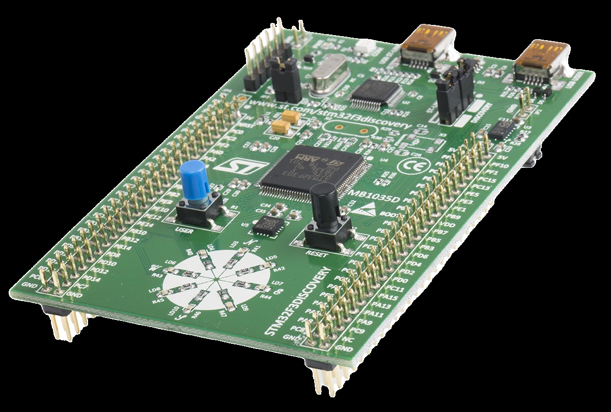

---

## 📑 Indice

1. [L'idea](#1--lidea)
2. [La soluzione](#2--la-soluzione)
3. [Hardware](#3--hardware)
4. [Schema circuitale e pin](#4--schema-circuitale-e-pin)
5. [Protocolli e frequenze](#5--protocolli-e-frequenze)
6. [Funzionamento](#6--funzionamento)
7. [Implementazione](#7--implementazione)
8. [Considerazioni finali](#8--considerazioni-finali)

---

## 1. 💡 L'idea

Il sistema ha come obiettivo la **gestione centralizzata delle luci e dell'impianto di climatizzazione di una smart home**.

## 2. ✅ La soluzione

La scheda di sviluppo **STM32F3 Discovery** permette la gestione, sia **automatica** che **manuale**, di luci e servomotori mediante l'utilizzo dei pin.

---

## 3. 🔧 Hardware

### Caratteristiche della scheda

1. **CPU:** core ARM® Cortex®-M4 a 32 bit RISC
2. **Memoria:** 256 KB di Flash e 48 KB di SRAM
3. **Periferiche integrate:** giroscopio e LED

### Componenti impiegati

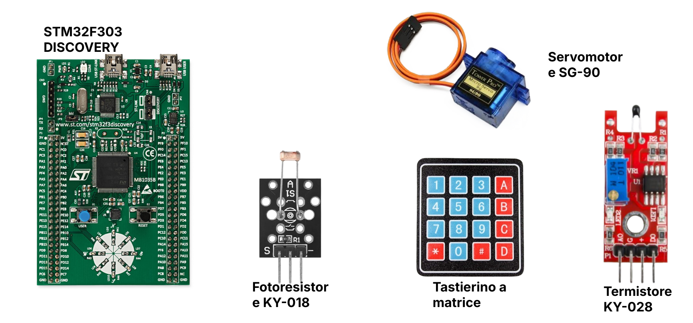

| Componente | Ruolo |
|---|---|
| STM32F303 Discovery | Microcontrollore / nodo unico di controllo |
| Fotoresistore KY-018 | Sensore di luminosità |
| Termistore KY-028 | Sensore di temperatura |
| Tastierino a matrice | Controllo manuale di luci e climatizzatore |
| Servomotore SG-90 | Simula il climatizzatore bi-valente |

---

## 4. 🔌 Schema circuitale e pin

### Schema circuitale

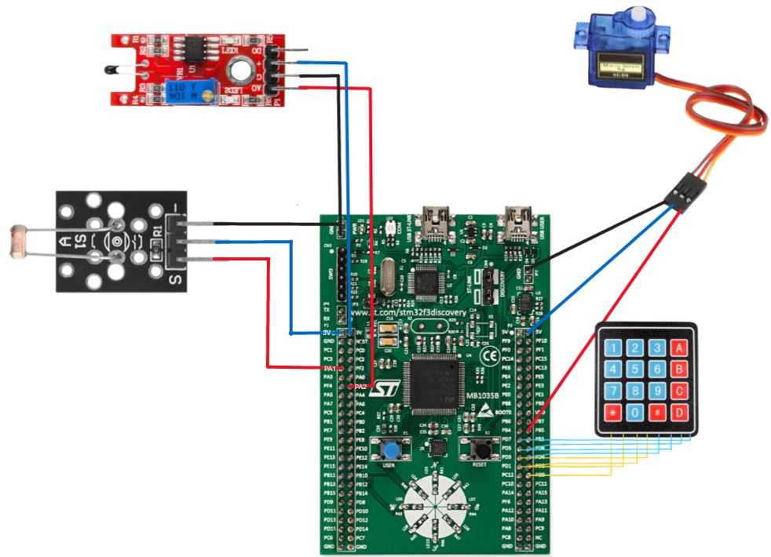

### Schema grafico dei pin

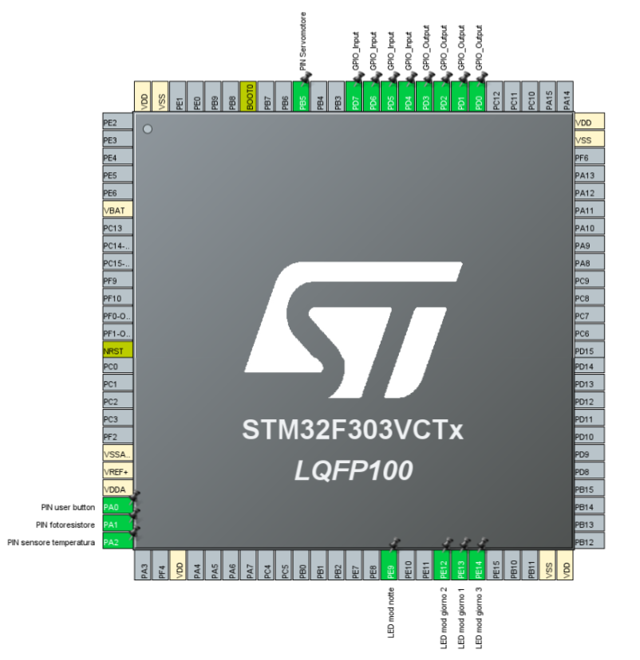

---

## 5. 📡 Protocolli e frequenze

| Componente | Protocollo / interfaccia |
|---|---|
| Sensori di temperatura e luminosità | **ADC1** |
| Tastierino a matrice | **GPIO digitale parallela** |
| Servomotore | **PWM** |

| Parametro | Frequenza |
|---|---|
| Clock di sistema (SYSCLK) | **8 MHz** |
| Timer 3 (generazione PWM servo) | **50 Hz** |
| Lettura sensori | **2 Hz** (una lettura ogni mezzo secondo) |

---

## 6. ⚙️ Funzionamento

### Diagramma di funzionamento

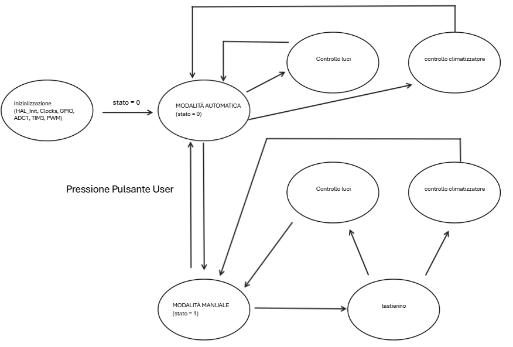

Il sistema può lavorare in **due modalità**:

1. **🤖 Modalità automatica** — il sensore di luminosità gestisce le luci di casa, il sensore di temperatura gestisce il servomotore che funge da climatizzatore bi-valente.
2. **🕹️ Modalità manuale** — i sensori rimangono attivi solo per il monitoraggio; luci e climatizzatore sono controllati manualmente con il tastierino.

Il **tasto USER** integrato nella scheda viene sfruttato per il **cambio modalità**.

---

## 7. 💻 Implementazione

### Lettura sensori

Si acquisiscono i valori dei sensori; per la temperatura è necessaria una **conversione**. Si utilizza la variabile *tick* e non i delay, per **evitare il busy waiting**.

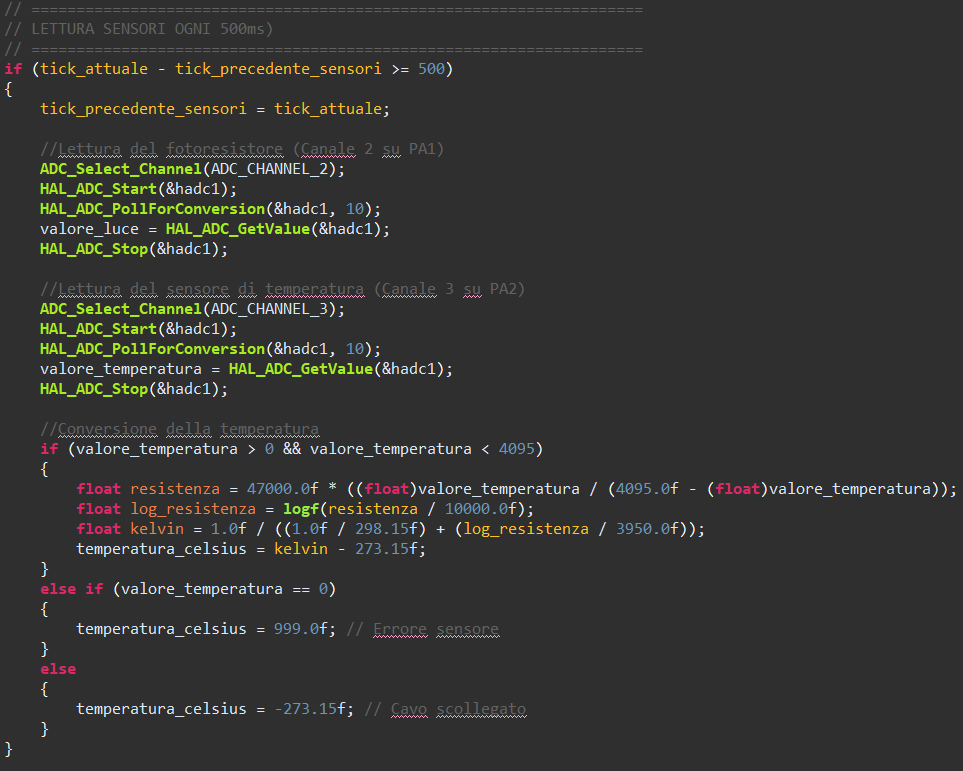

### Modalità automatica

La gestione della smart home è totalmente automatizzata: vengono stabilite delle condizioni da rispettare per la gestione di luci e climatizzazione.

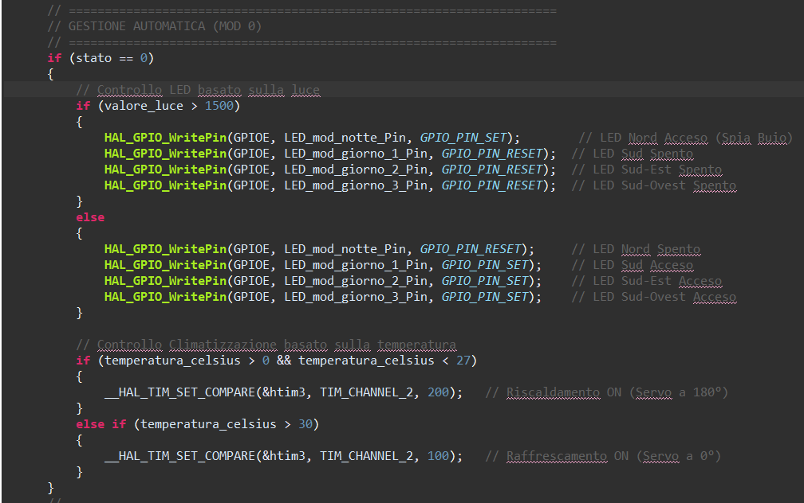

### Modalità manuale

La gestione è manuale e centralizzata, tramite il tastierino numerico.

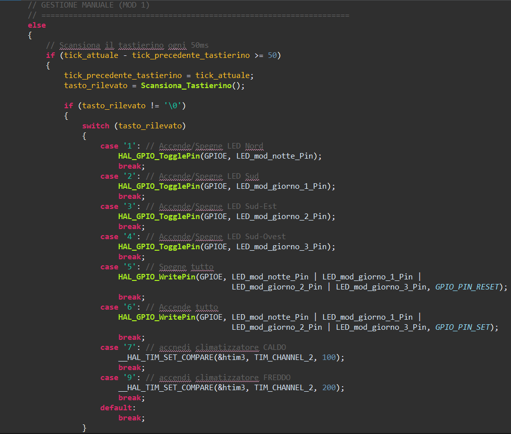

### Funzione cambio canale ADC

Serve per acquisire i dati da un canale o dall'altro. È necessaria perché sarebbe impossibile leggere correttamente due sensori in modo alternato.

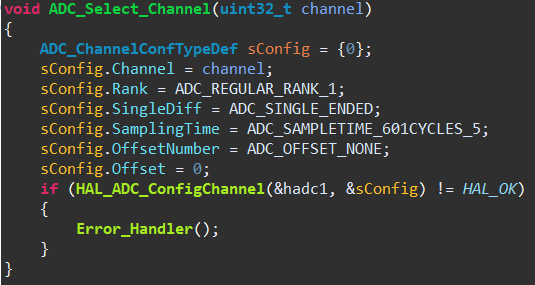

### Funzione cambio modalità

Funzione *interrupt driven* che permette di cambiare stato premendo il tasto USER della scheda. Anche in questo caso è gestito il **debounce** del pulsante.

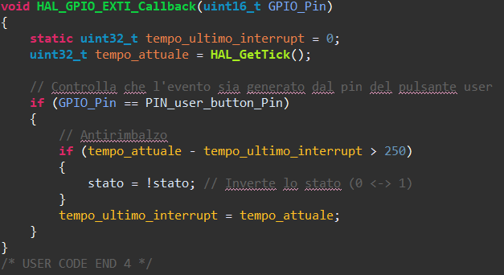

### Funzione tastierino

Il tastierino viene letto con logica **riga-colonna**, con meccanismi per evitare letture errate e **debouncing**.

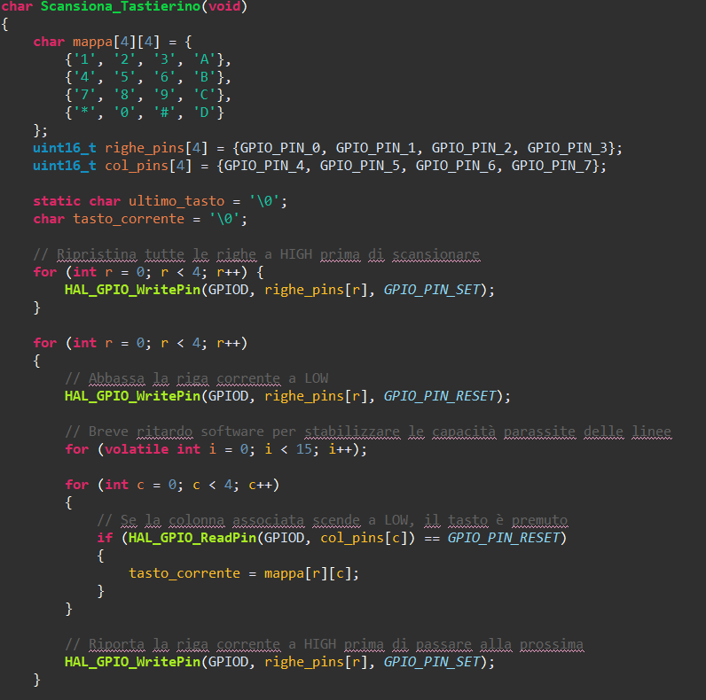

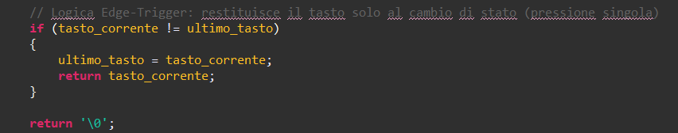

---

## 8. 🏁 Considerazioni finali

- Il progetto ha evidenziato l'importanza dei **sensori** nella progettazione di sistemi avanzati di domotica.
- L'utilizzo di **un unico nodo** per tutte le operazioni è stata una sfida, soprattutto per la **stabilità**.
- La modalità automatica è migliorabile aggiungendo altri sensori (ad esempio uno o più **sensori di movimento**) per una gestione migliore delle luci.
