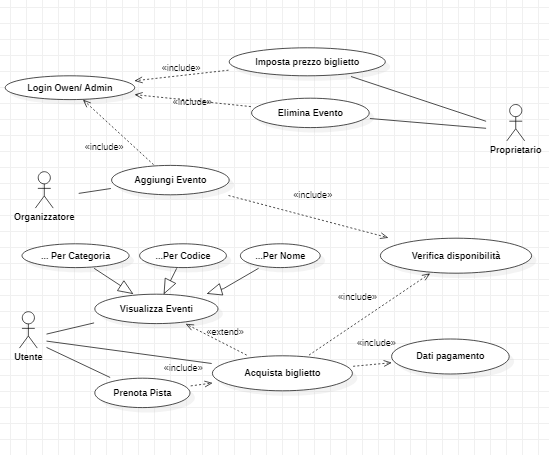
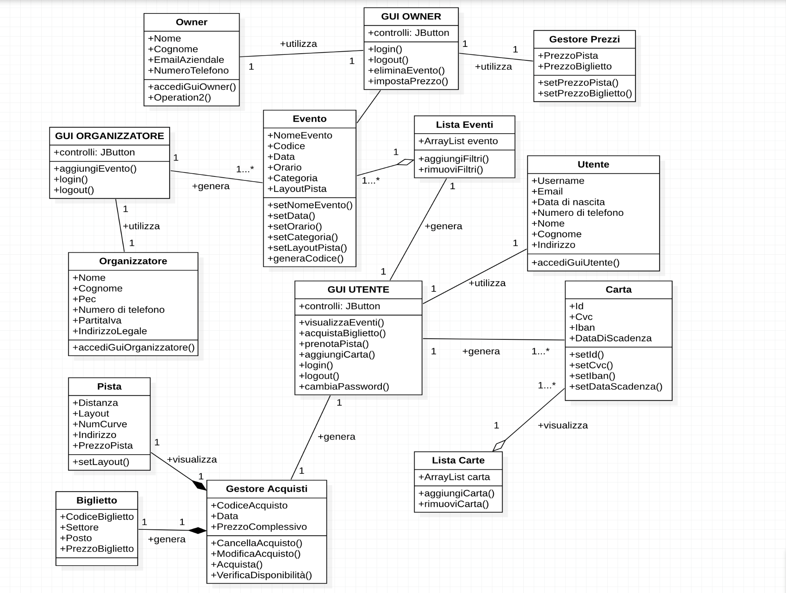
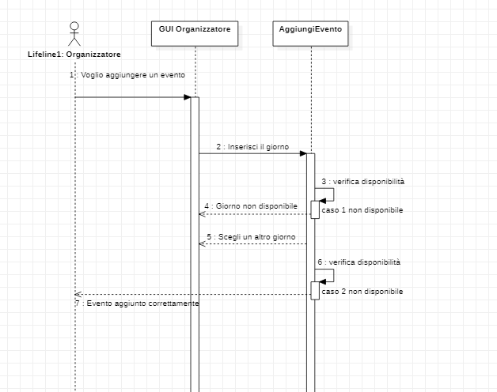
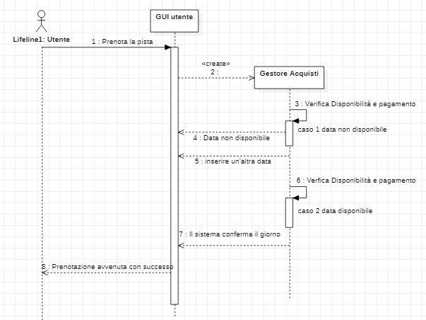
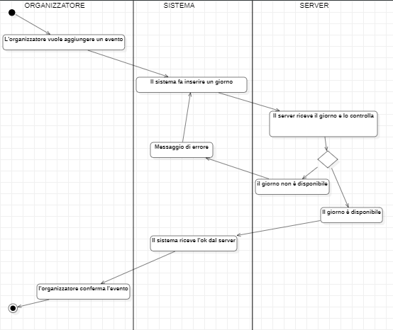
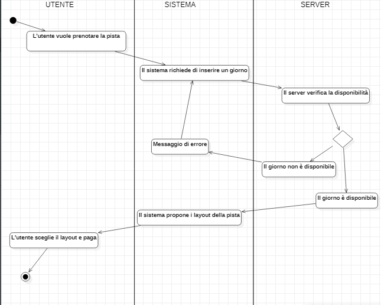
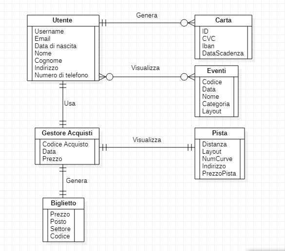
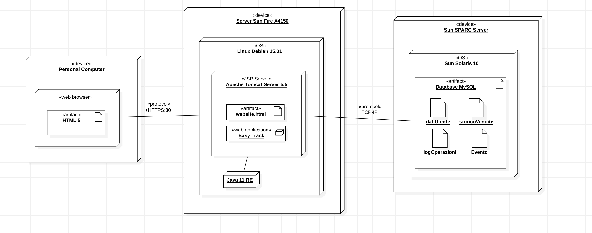

# 🏎️ EasyTrack

**Applicativo per la gestione di un autodromo** — eventi, prenotazioni della pista e biglietteria.

**Autori:** Antonio D'Angiolella (Mat. A13001849) · Emilio Verde (Mat. A13001311)

---

## 📑 Indice

1. [Descrizione dell'applicativo](#1--descrizione-dellapplicativo)
2. [Requisiti](#2--requisiti)
3. [Diagramma dei casi d'uso](#3--diagramma-dei-casi-duso)
4. [Diagramma delle classi](#4--diagramma-delle-classi)
5. [Diagrammi delle sequenze](#5--diagrammi-delle-sequenze)
6. [Diagrammi delle attività](#6--diagrammi-delle-attività)
7. [Diagramma E-R](#7--diagramma-e-r)
8. [Diagramma di sviluppo](#8--diagramma-di-sviluppo)

---

## 1. 📝 Descrizione dell'applicativo

Il progetto è pensato per la **gestione a 360° di un autodromo**. Gestire un circuito può essere difficile, perché bisogna districarsi tra i vari eventi e le prenotazioni dei piloti per i test privati.

Lo scopo dell'applicativo è **facilitare la gestione degli eventi, dei test** e di tutto ciò che riguarda l'autodromo. L'applicativo è inoltre rivolto all'utente che vuole **informarsi su eventi e costi** per la prenotazione della pista.

---

## 2. ✅ Requisiti

### Requisiti informali

Il cliente richiede che l'utente possa:

- Visualizzare gli eventi in programma
- Prenotare la pista per una o più giornate
- Acquistare un biglietto per uno di questi eventi
- Registrare il proprio account per ottenere informazioni

L'**organizzatore** può inserire nuovi eventi previa disponibilità.

### Requisiti funzionali

| # | Descrizione |
|---|---|
| 1 | Il programma deve permettere all'utente di **prenotare la pista** per un test |
| 2 | Il programma deve permettere all'utente di **visualizzare gli eventi** in programma |
| 3 | Il programma deve permettere all'utente di **acquistare biglietti** per uno o più eventi |
| 4 | Il programma deve permettere all'utente di **ricercare un evento per categoria** automobilistica (GT, Formula, Prototipi, Kart, ecc.) |
| 5 | Il programma deve consentire all'utente di **registrare il proprio account** |

### Requisiti non funzionali

| # | Descrizione |
|---|---|
| 1 | L'applicativo deve essere *user friendly* |
| 2 | L'applicativo deve trattare i dati personali in modo sicuro |
| 3 | L'applicativo deve essere manutenibile ed evolvibile |

---

## 3. 🎭 Diagramma dei casi d'uso

Descrive una tipica interazione tra uno degli attori e il sistema.

**Attori**

| Attore | Ruolo |
|---|---|
| **Admin / Proprietario** | Amministratore/proprietario dell'autodromo |
| **Utente** | Pilota o semplice appassionato |
| **Organizzatore** | Addetto all'organizzazione di eventi nell'autodromo |

### Caso d'uso: Acquista biglietto

- **Attori:** Utente
- **Precondizioni:** aver effettuato il login
- **Scenario:**
  1. L'utente sceglie l'evento a cui è interessato
  2. Il sistema verifica che i biglietti non siano terminati
  3. L'utente inserisce i dati di pagamento
  4. L'utente riceve una mail con una OTP da inserire durante il check-out
- **Post-condizioni:** l'ordine va a buon fine
- **Scenario alternativo 1 — dati di pagamento errati:** al passo 4 il sistema s'accorge che i dati sono errati → 1.1 viene richiesto all'utente di reinserirli
- **Scenario alternativo 2 — OTP non inserita in tempo:** al passo 5 il sistema s'accorge che la OTP non è stata inserita in tempo → 2.1 viene richiesto all'utente di fornire un'altra mail

### Caso d'uso: Visualizza eventi

- **Attori:** Utente
- **Precondizioni:** l'utente si connette al portale e si sposta nella sezione eventi
- **Scenario:**
  1. L'utente visualizza i prossimi eventi
  2. L'utente effettua la ricerca scegliendo un filtro (codice evento, categoria, data)
  3. Il sistema riceve la richiesta
  4. Il sistema ricerca l'evento desiderato con le condizioni date
- **Post-condizioni:** il sistema ritorna l'evento o gli eventi cercati
- **Scenario alternativo 1 — nessun evento trovato:** al passo 4 il sistema s'accorge che non esiste un evento con i criteri desiderati, restituendo un messaggio d'errore → 1.1 l'utente cambia criteri di ricerca

### Caso d'uso: Prenota pista

- **Attori:** Utente
- **Precondizioni:** l'utente si connette al portale e si sposta nella sezione prenotazioni
- **Scenario:**
  1. L'utente richiede la prenotazione della pista
  2. L'utente visualizza tutti i layout disponibili e ne sceglie uno
  3. Il sistema riceve la richiesta
  4. L'utente inserisce i dati di pagamento
  5. L'utente riceve una mail con una OTP da inserire durante il check-out
- **Post-condizioni:** il sistema conferma la prenotazione
- **Scenario alternativo 1 — pista non disponibile:** al passo 2 il sistema notifica che la pista non è disponibile → 1.1 l'utente sceglie un altro giorno per la prenotazione

### Caso d'uso: Aggiungi evento

- **Attori:** Organizzatore
- **Precondizioni:** l'organizzatore ha verificato la disponibilità della pista nel giorno previsto
- **Scenario:**
  1. L'organizzatore inserisce l'evento nel calendario
  2. L'organizzatore definisce i dettagli (codice, orario, categoria, layout previsto)
  3. Il sistema riceve la richiesta
- **Post-condizioni:** l'evento viene visualizzato nel calendario
- **Scenario alternativo 1 — codice evento già esistente:** al passo 2 il sistema notifica che il codice scelto corrisponde a un evento già esistente → 1.1 l'organizzatore deve cambiare codice
- **Scenario alternativo 2 — errore inserimento:** al passo 1 il sistema non risponde → 2.1 l'organizzatore verifica la propria connessione

### Caso d'uso: Imposta prezzo

- **Attori:** Proprietario
- **Precondizioni:** il proprietario si autentica
- **Scenario:**
  1. Il proprietario sceglie uno dei servizi che l'autodromo offre
  2. Il proprietario decide il prezzo del servizio
  3. Il sistema conferma la modifica
- **Post-condizioni:** il nuovo prezzo viene visualizzato correttamente

---

## 4. 🧱 Diagramma delle classi

Pone le basi per lo sviluppo concreto del sistema: descrive tutte le classi usate nella progettazione (con metodi e attributi) e le relazioni tra di esse.

---

## 5. 🔁 Diagrammi delle sequenze

Descrivono come un attore si interfaccia con gli oggetti e come questi si scambiano informazioni. Casi analizzati: **Aggiungi evento** e **Prenota pista**.

### 5.1 Aggiungi evento

### 5.2 Prenota pista

---

## 6. 🔀 Diagrammi delle attività

Descrivono le dinamiche con cui si svolgono i diversi casi d'uso, individuando le attività componenti, i loro punti d'incontro e il parallelismo intrinseco.

### 6.1 Aggiungi evento

### 6.2 Prenota pista

---

## 7. 🗂️ Diagramma E-R

Il modello Entità-Relazione, realizzato nelle fasi iniziali, identifica le entità dell'applicativo e le relazioni tra di esse.

**Entità:** Utente · Pista · Gestore Acquisti · Biglietto · Eventi · Carta

---

## 8. 🖥️ Diagramma di sviluppo

Descrive l'applicativo dal punto di vista delle **risorse hardware** (nodi), collegate tramite relazioni e protocolli, e delle **risorse software** usate dai nodi.

| Nodo | Software |
|---|---|
| Personal Computer | Web browser (HTML 5) |
| Server Sun Fire X4150 | Linux Debian, Apache Tomcat 5.5 (JSP), web application *Easy Track*, Java 11 RE |
| Sun SPARC Server | Sun Solaris 10, database MySQL |

Collegamenti: PC ↔ server via **HTTPS:80**; server ↔ database via **TCP-IP**.

---

<b>Fine presentazione</b>

