# 🏠 Smart Home Controller

Sistema di **domotica basato su ESP32-S3** che legge la temperatura, controlla le luci e comunica con un database MySQL e con un'interfaccia web.

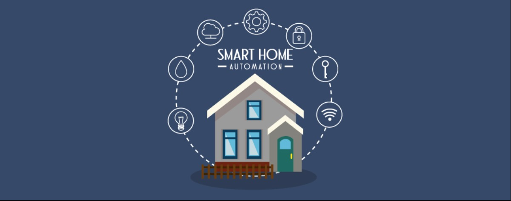

---

## 📑 Indice

1. [Panoramica](#1--panoramica)
2. [Architettura](#2--architettura)
3. [Sketch di codice](#3--sketch-di-codice)
4. [Struttura del progetto](#4--struttura-del-progetto)
5. [Perché ESP32?](#5--perché-esp32)
6. [Database](#6--database)
7. [Esempi di utilizzo](#7--esempi-di-utilizzo)
8. [Tecnologie impiegate](#8--tecnologie-impiegate)

---

## 1. 🎯 Panoramica

Questo documento presenta:

1. Sketch di codice
2. Struttura del progetto
3. Esempi di utilizzo del sistema
4. Elenco delle tecnologie impiegate

---

## 2. 🔗 Architettura

Comunicazione e **scambio di dati circolare** tra i vari dispositivi: il microcontrollore ESP32-S3, il database e i dispositivi client (PC, tablet, smartphone).

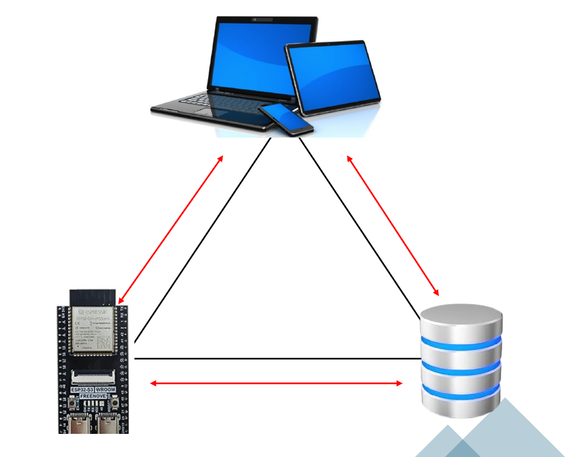

---

## 3. 💻 Sketch di codice

Il firmware è scritto in **Arduino (C++)** per ESP32-S3. In base agli screenshot, lo sketch:

- si connette al Wi-Fi e crea anche un **access point** con un proprio web server (porta 80);
- legge la temperatura da un **termistore** e la invia al server PHP ogni 60 secondi tramite richiesta HTTP POST;
- accende LED diversi in base alla temperatura misurata;
- controlla lo stato della luce tramite **pulsante fisico** e richieste HTTP al server.

> ℹ️ In questa versione del README SSID e password del Wi-Fi sono stati oscurati negli screenshot.

### Dichiarazioni, pin e `setup()`

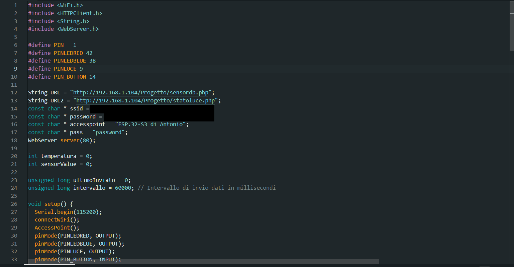

### `loop()`: pulsante, lettura sensore

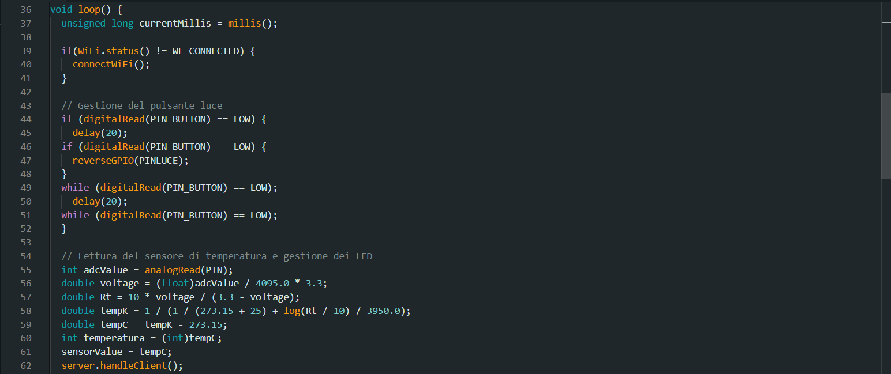

### Invio dei dati al server e gestione LED

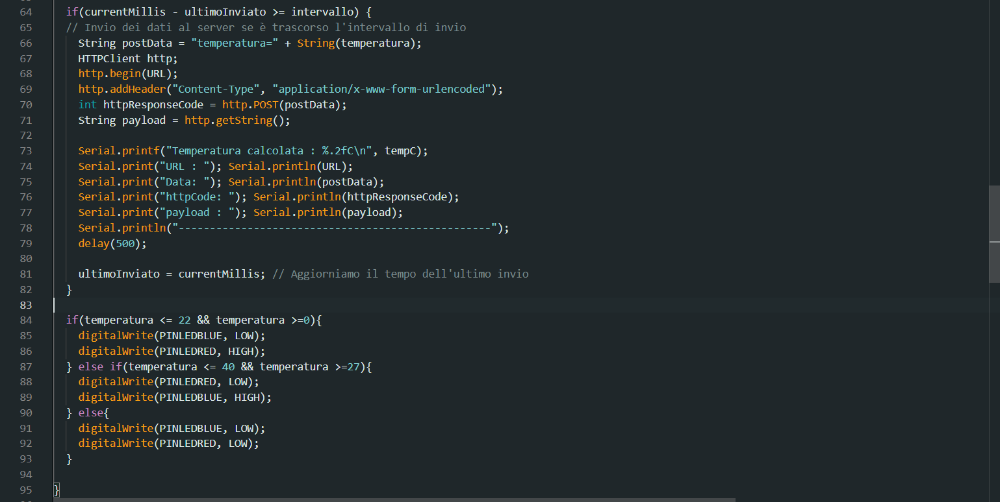

### Connessione Wi-Fi e stato della luce

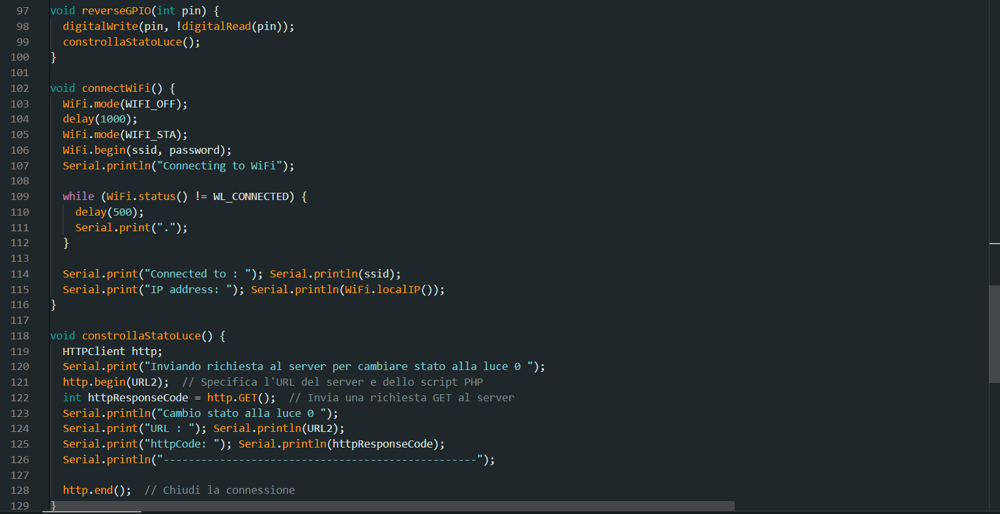

### Web server e pagine HTML

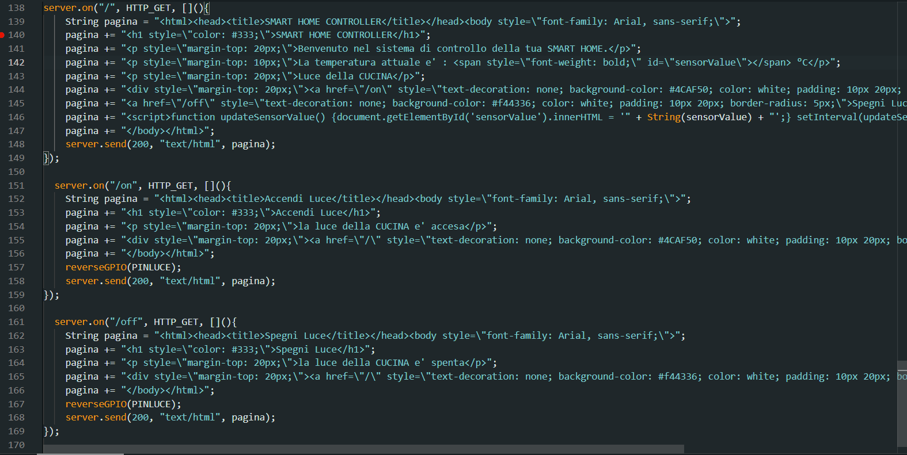

### Access point

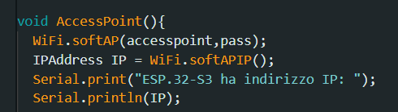

---

## 4. 📂 Struttura del progetto

Lato server sono presenti quattro script PHP:

| File | Ruolo |
|---|---|
| `sensordb.php` | Riceve e salva nel database le temperature inviate dall'ESP32 |
| `statoluce.php` | Gestisce lo stato della luce |
| `VisualizzaTemp.php` | Mostra le temperature registrate |
| `VisualizzaLuci.php` | Mostra lo stato delle luci |

---

## 5. ⚡ Perché ESP32?

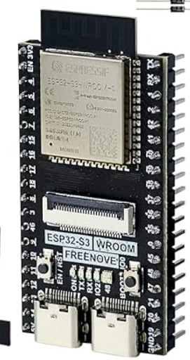

1. Processore **dual-core a 32 bit**
2. **Wi-Fi e Bluetooth** integrati
3. Ricca interfaccia periferica e **GPIO**
4. Ampia disponibilità di memoria (**4 MB di flash** e fino a **520 KB di RAM**)
5. Ecosistema di sviluppo software

---

## 6. 🗄️ Database

Per il database è usato **MySQL**, con **XAMPP** per la creazione del server e **phpMyAdmin** per la creazione del database.

---

## 7. 🧪 Esempi di utilizzo

### Test caso d'uso ID = 0 — visualizzazione temperature

Dal menu *Smart Home DB* si scelgono "Visualizza Temperature Registrate" o "Visualizza stato delle Luci". Le temperature compaiono in tabella con data e ora.

| Menu | Temperature registrate |
|---|---|
| 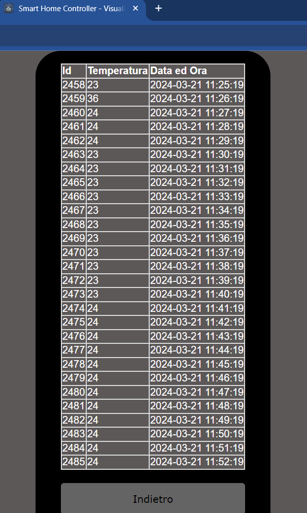 | 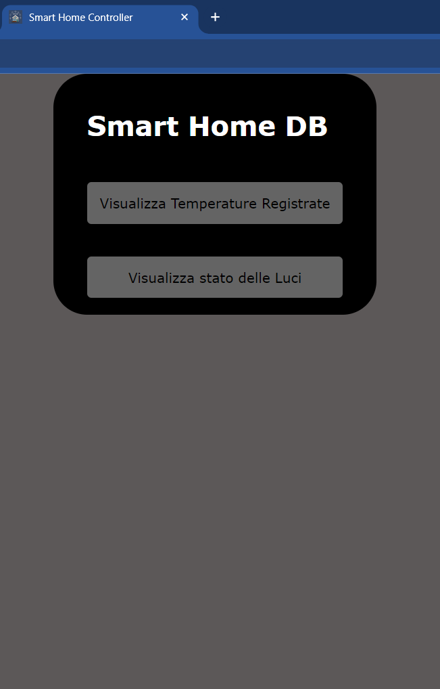 |

### Test caso d'uso ID = 4 — accensione della luce

| Prima | Dopo |
|---|---|
| 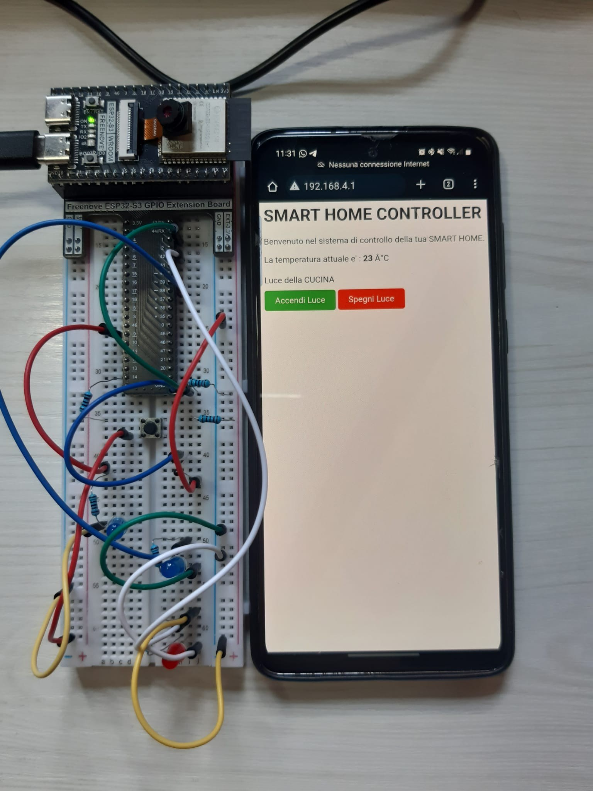 | 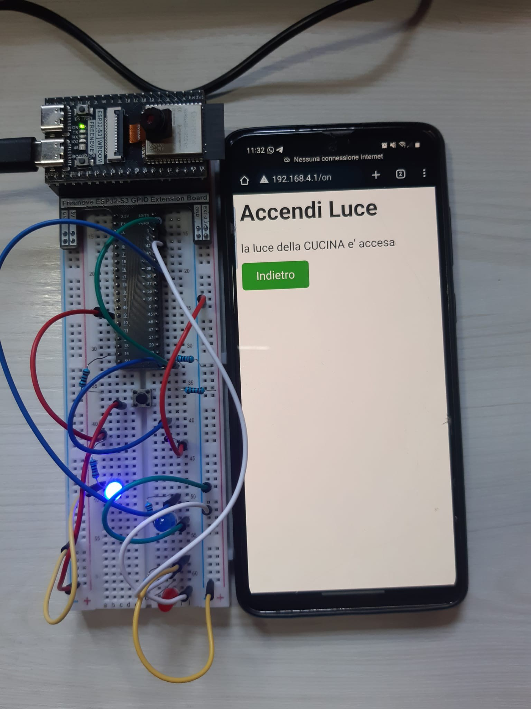 |

### Test caso d'uso ID = 4 — spegnimento della luce

| Prima | Dopo |
|---|---|
| 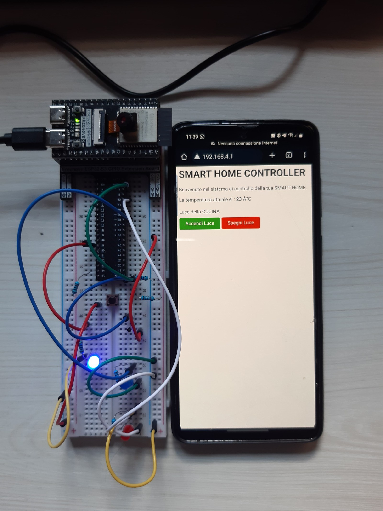 | 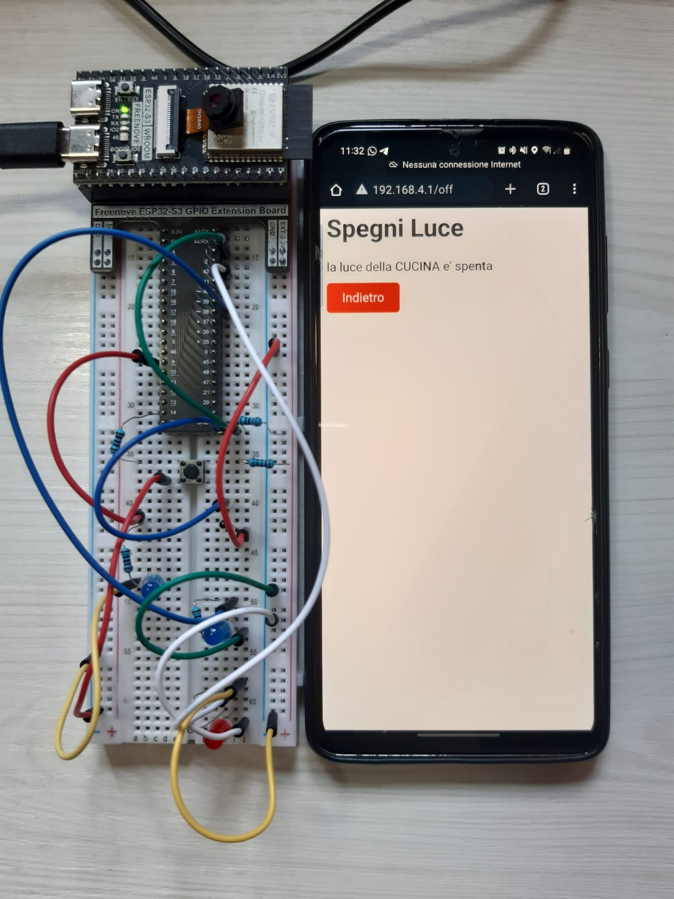 |

---

## 8. 🛠️ Tecnologie impiegate

1. Scheda di sviluppo **ESP32-S3**
2. **Arduino IDE**
3. **Visual Studio Code**
4. **XAMPP**
5. **phpMyAdmin**
6. **MySQL**
7. **Wokwi.com** (simulazione)
