# 🏎️ Analisi dei software di gestione degli aiuti alla guida su veicoli da competizione ad alte prestazioni

**Tesi di laurea — Dipartimento di Ingegneria**

| | |
|---|---|
| **Candidato** | Antonio D'Angiolella (Mat. A13001849) |
| **Relatore** | Prof. Antonio Esposito |
| **A.A.** | 2024/25 |

Modellazione, implementazione e simulazione in MATLAB delle logiche di **Traction Control (TC)** e **Anti-lock Braking System (ABS)** per auto da corsa, basate sul concetto di **slip ratio**.

---

## 📑 Indice

1. [Struttura dell'elaborato](#1--struttura-dellelaborato)
2. [Definizione di aiuto alla guida](#2--definizione-di-aiuto-alla-guida)
3. [Modellazione del problema](#3--modellazione-del-problema)
4. [Progettazione e implementazione del sistema](#4--progettazione-e-implementazione-del-sistema)
5. [Simulazione delle logiche](#5--simulazione-delle-logiche)
6. [Sviluppi futuri](#6--sviluppi-futuri)

---

## 1. 🗂️ Struttura dell'elaborato

L'elaborato è diviso in 5 parti:

1. Definizione di aiuto alla guida
2. Modellazione del problema
3. Progettazione e implementazione del sistema
4. Simulazione delle logiche del sistema
5. Sviluppi futuri e possibili migliorie

---

## 2. 🚗 Definizione di aiuto alla guida

### ADAS — Advanced Driver Assistance Systems

Sistemi che aiutano a ridurre i rischi sia per i conducenti sia per gli utenti deboli della strada (pedoni, ciclisti). Caratteristiche:

- **Sicurezza**
- Utilizzo di una **grande quantità di dati**
- Tempi di risposta nell'ordine dei **millisecondi**
- **Intervento attivo**

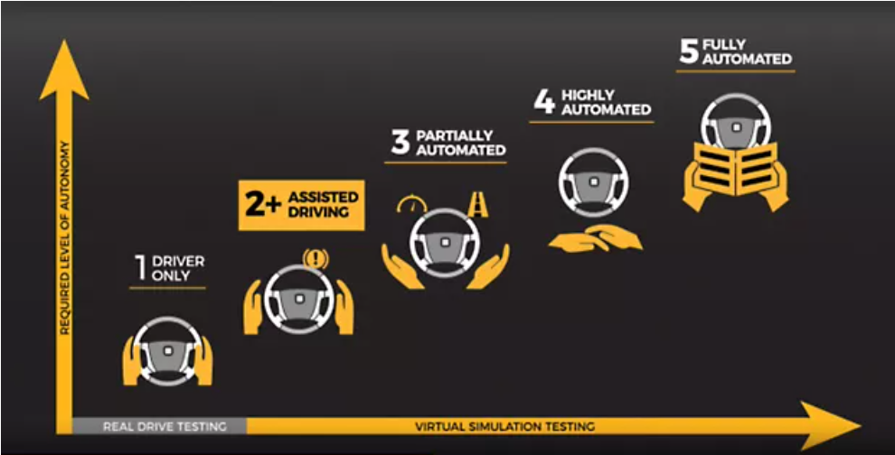

In questa trattazione si analizzano aiuti di **livello 2**.

### Alcuni aiuti noti

| Sigla | Nome | Funzione |
|---|---|---|
| **ACC** | Adaptive Cruise Control | Mantiene la velocità impostata regolando automaticamente la distanza dal veicolo davanti |
| **AEB** | Automatic Emergency Braking | Frena autonomamente in caso di rischio collisione |
| **LKA** | Lane Keeping Assist | Corregge lo sterzo per mantenere l'auto in corsia |
| **LDW** | Lane Departure Warning | Avvisa se il veicolo supera la linea di corsia senza freccia |
| **BSD** | Blind Spot Detection | Segnala la presenza di veicoli nell'angolo cieco |
| **RCTA** | Rear Cross Traffic Alert | Avvisa di traffico trasversale in retromarcia |
| **TSR** | Traffic Sign Recognition | Riconosce e mostra i segnali stradali |
| **DM** | Driver Monitoring | Rileva distrazione o stanchezza del conducente |
| **PA** | Parking Assist | Aiuta nelle manovre di parcheggio, fino a gestirle autonomamente |

### Strada vs pista

Per le auto da corsa questi aiuti non servono: gli obiettivi sono diversi.

| STRADA | PISTA |
|---|---|
| 1. Sicurezza per tutti gli utenti | 1. Sicurezza per piloti e steward |
| 2. Comfort | 2. Limite del veicolo |
| 3. Riduzione di inquinamento atmosferico e acustico | 3. Tempo sul giro |

Gli aiuti per le auto da corsa **dipendono dal regolamento sportivo**. Tra i più comuni: *traction control*, *anti-lock braking system*, *launch control*, *pit limiter*, ecc.

> In questo lavoro ci si concentra su **TC** e **ABS**.

---

## 3. 📐 Modellazione del problema

### Panoramica generale del sistema

I dati dei sensori arrivano alla centralina, che comanda gli attuatori: il sistema di iniezione (TC) e il sistema frenante (ABS).

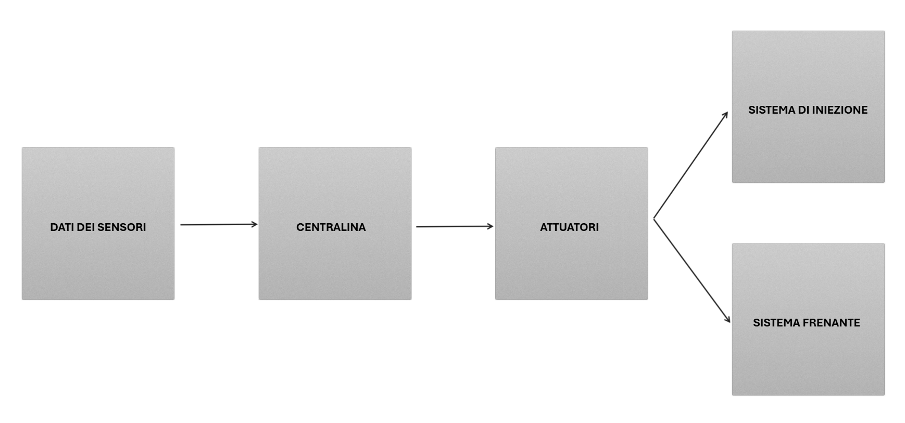

### Dinamica del veicolo

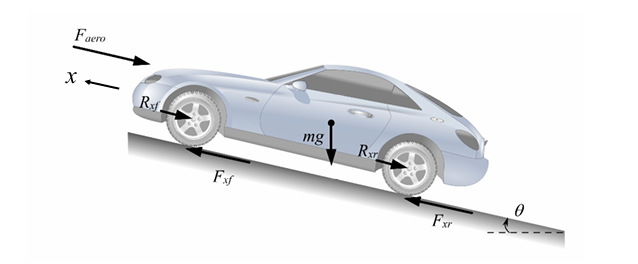

$$
m\ddot{x} = F_{xf} + F_{xr} - F_{aero} - R_{xf} - R_{xr} - mg\sin\theta
$$

Nella trattazione ci si concentra solo sulle **forze di interazione tra pneumatico e asfalto** ($F_{xf}$ e $F_{xr}$), che dipendono da vari parametri:

- **Slip ratio:** rapporto tra velocità tangenziale e velocità angolare
- **Carico normale dello pneumatico:** forza verticale che agisce sulla superficie dello pneumatico e determina la quantità massima di forza di attrito generabile
- **Coefficiente d'attrito** tra pneumatico e strada

### Slip ratio

L'elaborato ruota attorno al concetto di slip ratio.

**In frenata**

$$
\sigma_x = \frac{r_{eff}\,\omega_w - V_x}{V_x}
$$

**In accelerazione**

$$
\sigma_x = \frac{r_{eff}\,\omega_w - V_x}{r_{eff}\,\omega_w}
$$

### Relazione forza – slip ratio

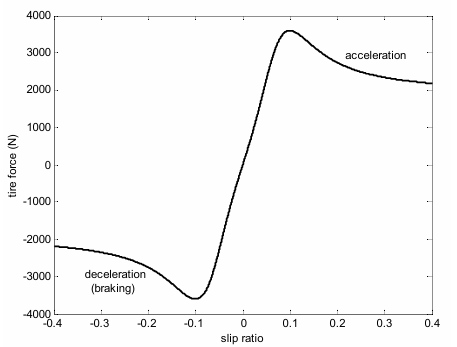

La forza di trazione è massima per slip ratio positivo (circa 0.1), la forza frenante è massima per slip ratio negativo (circa −0.1).

---

## 4. ⚙️ Progettazione e implementazione del sistema

### Dati necessari

| Grandezza | Sorgente |
|---|---|
| **Velocità angolare** della ruota | Sensore **WSS** (Wheel Speed Sensor) |
| **Velocità lineare** del veicolo | Accelerometri, GPS, fotocellule, ecc. |

Entrambi servono a calcolare lo slip ratio.

**Sistema per ottenere la velocità di rotazione della ruota**

 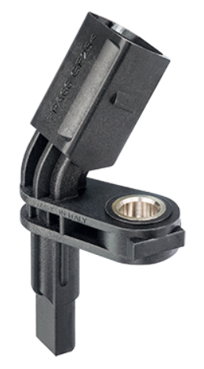 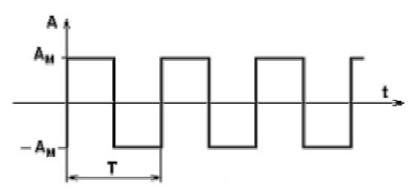

### ECU — Engine Control Unit

Controlla tutte le funzioni elettroniche del veicolo: è il **cervello elettronico** del veicolo. Riceve i dati da una rete di sensori e li elabora.

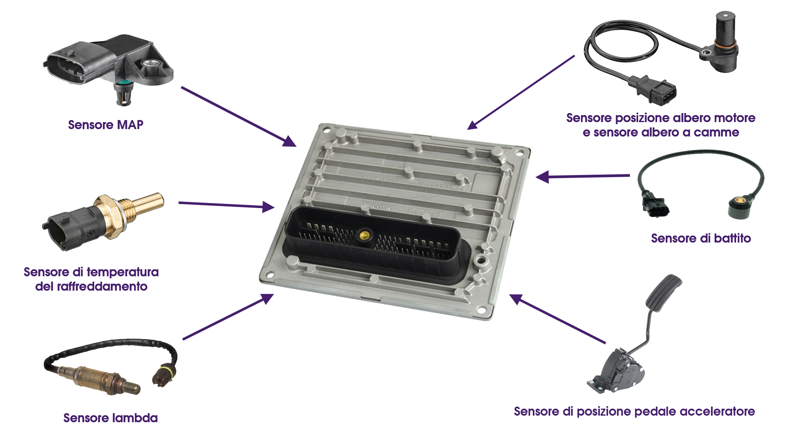

### Codice

**Velocità angolare** — qui la misura è stata effettuata davvero (conteggio degli impulsi del WSS):

```cpp
float get_Omega() {
  unsigned long impulsi_attuali;

  cli();                                // DISABILITA TUTTI GLI INTERRUPT GLOBALI
  impulsi_attuali = CONTORE_IMPULSI;    // LEGGI il dato grezzo in sicurezza
  CONTORE_IMPULSI = 0;                  // AZZERA il contatore
  sei();                                // RIABILITA GLI INTERRUPT

  // === 2. ELABORAZIONE (Calcoli di Conversione) ===
  // a. Calcolo della Frequenza (Hz)
  float frequenza_hz = (float)impulsi_attuali / TEMPO_CAMPIONAMENTO;
  // b. Calcolo della Velocità Angolare (rad/s)
  float rad_per_impulso = (2.0 * M_PI) / PPR;
  float velocita_rad_s = frequenza_hz * rad_per_impulso;

  return velocita_rad_s;
}
```

**Velocità lineare** — si prende il valore letto da un ipotetico sensore, senza specificare come venga misurata:

```cpp
float get_Vx() {
  float velocita_lineare_ms = readLinearSpeedSensor(); // funzione che ritorna il valore della velocità lineare
  return velocita_lineare_ms;
}
```

**Calcolo dei due slip ratio** nella funzione `loop()`:

```cpp
void loop() {
  float Omega = get_Omega(); // mi prendo la velocità angolare
  float Vx = get_Vx();       // mi prendo la velocità lineare

  float slip_ratio_ac = ((RAGGIO_GOMMA_M*Omega)-(Vx))/(RAGGIO_GOMMA_M*Omega); // slip ratio in accelerazione, serve per il TC
  float slip_ratio_br = ((RAGGIO_GOMMA_M*Omega)-(Vx))/(Vx);                   // slip ratio in frenata, serve per l'ABS
```

### Cosa succede se c'è una perdita di trazione? (TC)

```cpp
if (slip_ratio_ac > VALORE_IDEALE_AC) {
  TC_cut(livelloTC, slip_ratio_ac);
}
```

```cpp
void TC_cut(int livelloTC, float slip_ratio_ac) {
  int throttle_status = analogRead(THROTTLE_PIN);                  // leggo la % di acceleratore
  float taglio = (slip_ratio_ac * CUT_CONST * livelloTC);          // CUT_CONST = 8
  float aux = (throttle_status - taglio);                          // variabile ausiliaria da imporre come potenza al motore
  aux = constrain(aux, 0, 100);                                    // limito la potenza dopo il taglio a stare tra 0 e 100%
  analogWrite(ENGINE_PIN, aux);                                    // do il valore di potenza al motore
}
```

### Cosa succede se c'è un bloccaggio in frenata? (ABS)

```cpp
if (slip_ratio_br < VALORE_IDEALE_BR) {
  ABS_on(livelloABS, slip_ratio_br);
}
```

```cpp
void ABS_on(int livelloABS, float slip_ratio_br) {
  int brake_status = analogRead(BRAKE_PIN);                        // leggo la % di freno
  float rilascio = (slip_ratio_br * ABS_CONST * livelloABS);       // riduzione forza frenante
  float aux = (brake_status - rilascio);                           // nuova forza frenante
  aux = constrain(aux, 0, 100);                                    // limito tra 0 e 100%
  analogWrite(BRAKE_OUT_PIN, aux);                                 // applico la forza frenante al sistema
}
```

---

## 5. 🧪 Simulazione delle logiche

Per testare le logiche in **MATLAB** sono state usate funzioni matematiche che simulano l'andamento degli input di acceleratore e freno e dello slip ratio in accelerazione e frenata.

**Input acceleratore**

```matlab
% Input acceleratore (0→100%)
throttle_input = 100 * (1 - exp(-5*t));
```

**Slip ratio in accelerazione**

```matlab
% Normalizzazione del picco (Il picco nativo è ~0.07; lo scaliamo a 0.5)
MAX_SLIP_DESIDERATO = 0.5;
max_current_slip = max(slip_ratio);
slip_ratio = slip_ratio * (MAX_SLIP_DESIDERATO / max_current_slip);
```

**Input frenata**

```matlab
% --- Input frenata del pilota (0→100%) normalizzato ---
k1 = 50;  % velocità salita iniziale (fissa)
k2 = 3;   % velocità discesa (fissa)
brake_input_raw = (1 - exp(-k1 * t)) .* exp(-k2 * t);
brake_input = brake_input_raw / max(brake_input_raw) * 100;
```

**Slip ratio in frenata**

```matlab
% --- Funzione slip ratio simulata (da 0 a -1 e ritorno a 0) ---
slip_ratio = -exp(-5*t) .* (1 - exp(-10*t));   % forma a picco negativo
MAX_SLIP_DESIDERATO = -1;
slip_ratio = slip_ratio / min(slip_ratio) * MAX_SLIP_DESIDERATO;
```

### Traction Control

Nei grafici: in alto lo slip ratio nel tempo, in basso input dell'acceleratore (blu) e potenza modulata dal TC (rosso).

| Livello TC = 2 | Livello TC = 9 |
|---|---|
| 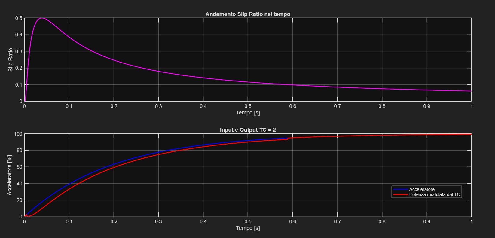 | 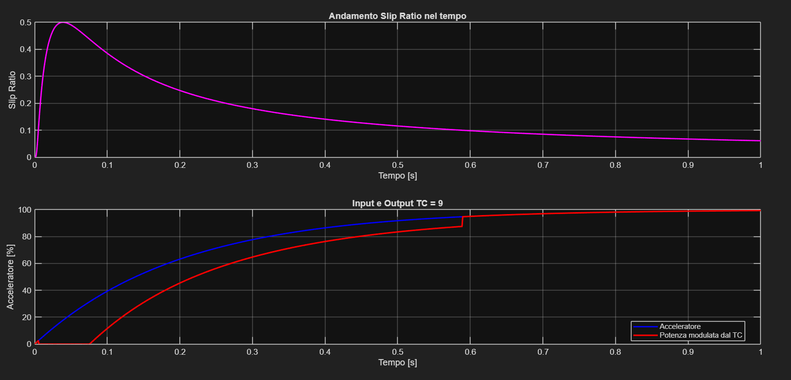 |

### ABS

Nei grafici: in alto lo slip ratio nel tempo, in basso input del freno (blu) e forza frenante modulata dall'ABS (rosso).

| Livello ABS = 2 | Livello ABS = 6 |
|---|---|
| 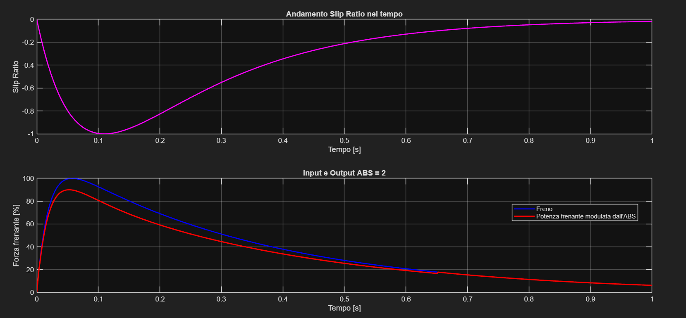 | 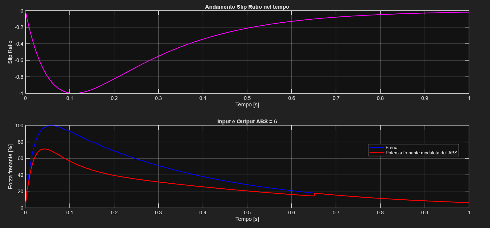 |

---

## 6. 🔭 Sviluppi futuri

1. Simulazioni con input generati da sensori
2. Installazione su auto da corsa per la raccolta di dati reali
3. Ridefinizione più efficace delle costanti di taglio

---

<p align="center"><b>Grazie per l'attenzione!</b></p>
